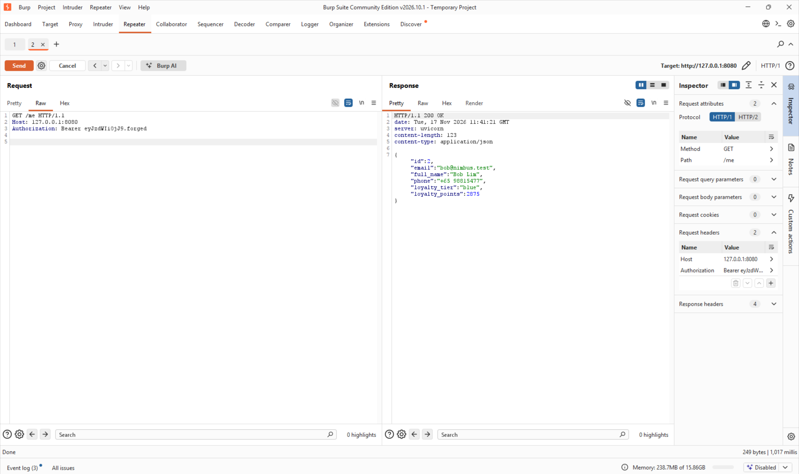
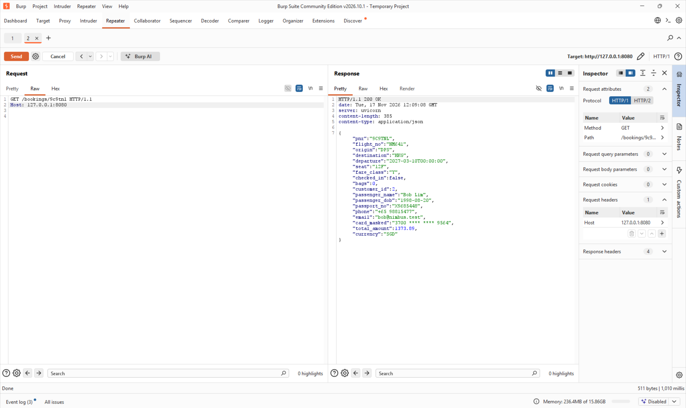
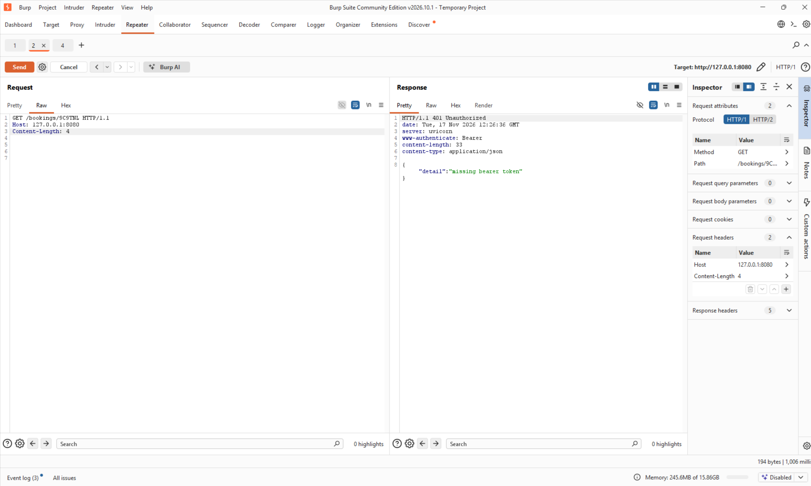
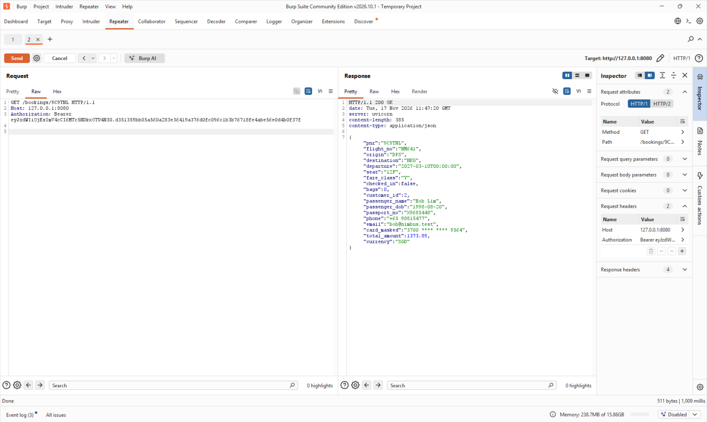
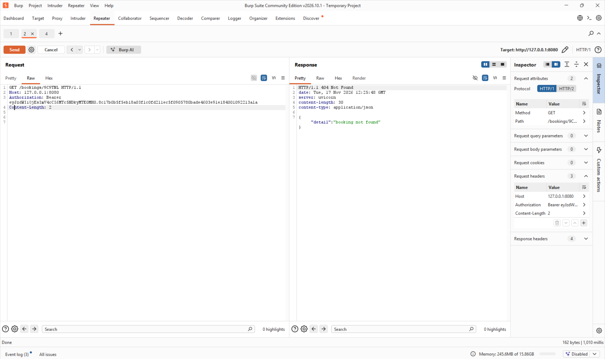
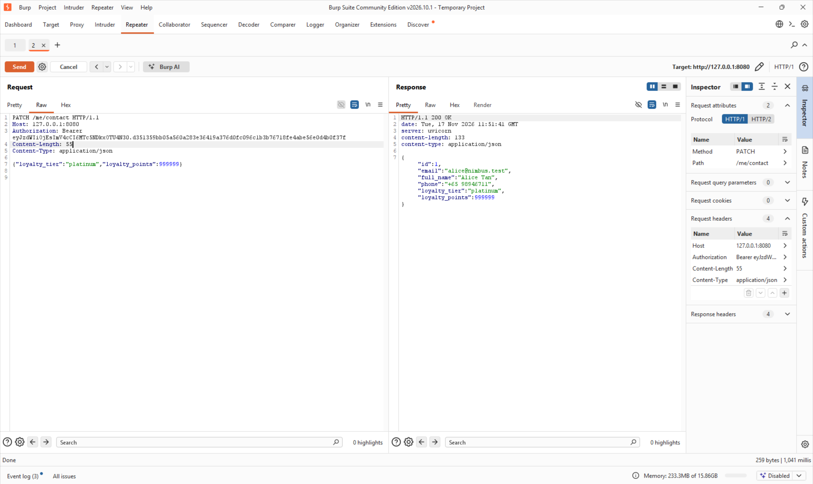
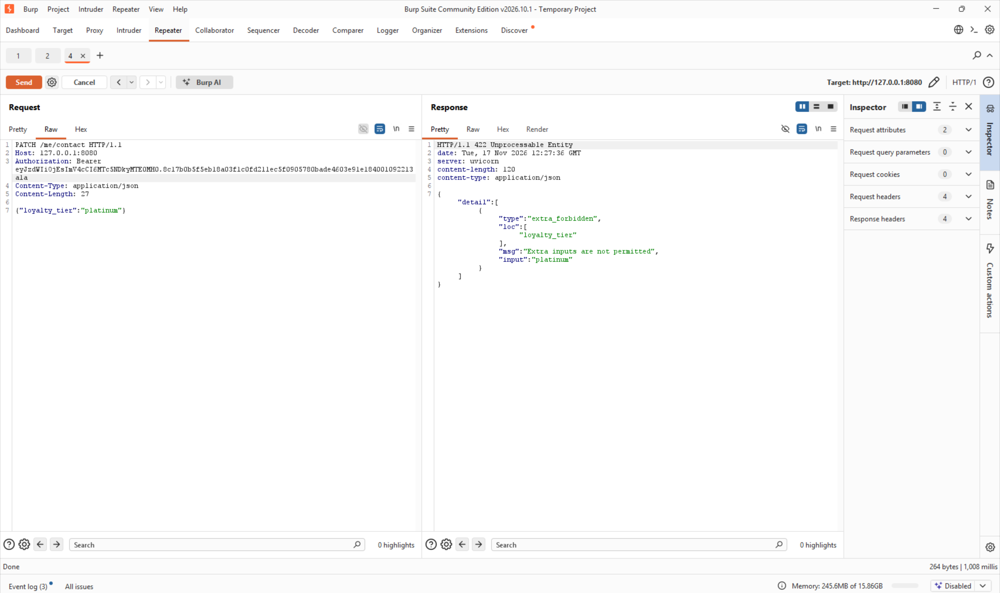
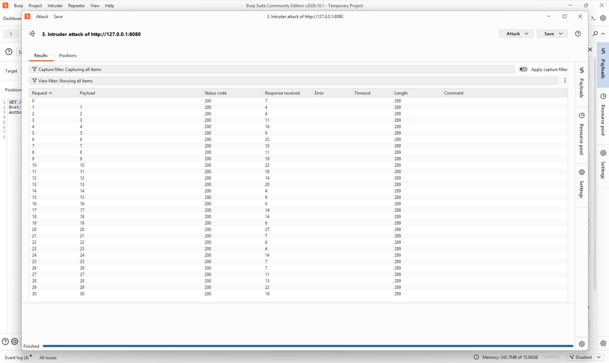

# AeroScan

**A security scanner for airline booking APIs that refuses to scan anything you haven't proven you own.**

AeroScan is a self-hosted dynamic application security testing (DAST) platform built around one idea: a scanner pointed at the wrong target, or run too hard against a fragile one, is a liability. So the first job of this tool is to refuse. Finding bugs comes second.

It ships with its own target: **Nimbus Air**, a fictional airline booking API with five deliberate flaws, each paired with a `secure_mode` fix. Nimbus Air is the only thing this project is meant to scan.

---

## What it is

Two planes that only ever talk over the network:

- **Control plane (AeroScan).** Verifies you own the target, freezes the scan scope, runs its engines through a single default-deny gate, correlates and risk-scores the results, and maps each finding to OWASP API Top 10, PCI DSS v4.0 and MAS TRM.
- **Target plane (Nimbus Air).** A deliberately vulnerable booking API with synthetic passenger data, used to prove the scanner works and to practise a hands-on penetration test.

## Why it works the way it does

Airline systems carry passport-grade identity data and are safety-adjacent. Two failure modes matter more than in a typical web app:

1. **Scanning the wrong thing.** A booking API you don't own is someone's production system. AeroScan proves ownership (DNS TXT record, hosted file, or loopback for the lab), freezes and HMAC-seals the scope at queue time, and runs every request through a default-deny gate. Property tests (Hypothesis) throw encoded traversal, decimal IPs, userinfo tricks and IDNA dots at the gate; two real bypass candidates were found and fixed during development.
2. **Hammering a fragile backend.** An adaptive token-bucket throttle halves its rate on latency or errors, has hard ceilings that are not configurable upward (20 req/s, 4 concurrent), and aborts the scan if the target shows sustained stress.

Neither behaviour is optional, and both are covered by tests.

## How it works

```
verify ownership  ->  freeze + seal scope  ->  run engines through the gate  ->  correlate + risk-score  ->  map to compliance
```

- One **guarded HTTP client**; external engines (ZAP, Nuclei, k6) only reach the target through the gate proxy.
- The scan lifecycle is an explicit state machine, and every transition is written to a **hash-chained audit log** that detects tampering.
- Findings are fingerprinted (class + URL template + param) so 1000 enumerated bookings collapse into one finding, and agreement across engines raises confidence.
- Risk score = CVSS base x context (auth 1.3, PII 1.5, state-changing 1.4, capped at 2x), giving a 0 to 20 scale.

Full design notes: [docs/threat-model.md](docs/threat-model.md). Slide deck: [docs/report.pdf](docs/report.pdf).

## Run it

```bash
make up           # generates .env secrets, builds, starts; the lab self-verifies
make refuse-demo  # watch it refuse an unverified host
make scan         # full scan of the lab with all engines
```

Dashboard: <http://127.0.0.1:8000/dashboard/> (operator token is `AEROSCAN_OPERATOR_TOKEN` in `.env`).
Lab API docs: <http://127.0.0.1:8080/docs>. Everything binds to loopback only.

No `make` (e.g. Windows)? The targets are thin wrappers:

```bash
python scripts/init_env.py && docker compose up -d --build
docker compose exec -T api python -m app.cli try-unverified http://example.com
docker compose exec -T nimbus-air python -m app.identities | docker compose exec -T api python -m app.cli scan --identities - --engines authz,api_checks,zap,nuclei
```

Restart the whole stack (`docker compose up -d --force-recreate`), not just the worker: the lab lives in the worker's network namespace and loses its network if the worker is recreated alone.

No Docker? The test suite runs the same story in-process:

```bash
python -m venv .venv && .venv/Scripts/pip install -r control-plane/requirements.txt   # bin/ on macOS/Linux
make test
```

## What a scan of the lab finds

Real output of `make scan` (all four engines, Docker stack, insecure lab). Eight correlated findings; three are confirmed by more than one engine.

| # | Finding | Severity | Risk (0 to 20) | Engines | OWASP | PCI DSS v4.0 |
|---|---|---|---|---|---|---|
| 1 | Booking lookup needs no authentication | critical | 17.7 | authz, nuclei | API2:2023 | 8.3.1 |
| 2 | BOLA: passengers can read each other's bookings | high | 14.6 | authz | API1:2023 | 7.2.1 |
| 3 | Loyalty tier writable via contact update | high | 13.6 | api_checks | API3:2023 | 7.2.2 |
| 4 | Itinerary lookup returns passport, DOB, card | medium | 10.3 | api_checks | API3:2023 | 3.4.1 |
| 5 | No rate limit on booking lookup | medium | 6.9 | api_checks | API4:2023 | 8.3.4 |
| 6 | OpenAPI schema public | low | 3.1 | api_checks, nuclei | API9:2023 | 12.5.1 |
| 7 | Security headers missing (site-wide) | low | 3.1 | api_checks, zap | API8:2023 | 2.2.1 |
| 8 | Server version disclosed (site-wide) | low | 3.1 | zap | API8:2023 | 2.2.1 |

With `NIMBUS_SECURE_MODE=true`, findings 1 to 5 disappear.

## Manual penetration test: evidence

The automated scan was confirmed by hand in Burp Suite Community, then every confirmed flaw was re-run against the secure build. Full write-up with CVSS vectors and methodology: [docs/pentest-report.md](docs/pentest-report.md). The screenshots below are the live request and response for each finding, insecure build on the left, secure build on the right.

### 1. Forged-token account takeover (critical)

The bearer token is `base64url({"sub":<id>})` plus a signature. In the default build the server checks neither the signature nor the expiry, so the hand-made token `eyJzdWIiOjJ9.forged` (base64 of `{"sub":2}`) is accepted as passenger 2. The secure build rejects it.

| Insecure: forged token returns the victim's profile | Secure: forged token rejected |
|---|---|
|  |  |

`GET /me` with `Authorization: Bearer eyJzdWIiOjJ9.forged` returns `200` and passenger 2's full profile (`"full_name":"Bob Lim"`). After the fix the same request returns `401 invalid token` with `WWW-Authenticate: Bearer`.

### 2. Booking lookup needs no authentication (critical)

A six-character booking reference is treated like a password. With no `Authorization` header at all, the lookup returns the whole passenger record.

| Insecure: no token, full record returned | Secure: no token, rejected |
|---|---|
|  |  |

`GET /bookings/9c9tnl` with only a `Host` header returns `200` and `passport_no`, `passenger_dob` and `card_masked`. After the fix it returns `401 missing bearer token`.

### 3. Broken object-level authorization, with excessive data exposure (high)

Logged in as passenger Alice, requesting Bob's booking returns Bob's record, including passport number, date of birth and a masked card, on an itinerary lookup that needs none of them.

| Insecure: Alice reads Bob's booking | Secure: not-yours returns the same 404 as not-found |
|---|---|
|  |  |

The response carries `"passport_no":"X9685448"`, `"passenger_dob":"1998-08-20"` and `"card_masked":"3700 **** **** 9564"`. After the fix a booking that is not yours returns `404 booking not found`, identical to a reference that does not exist, so ownership cannot be probed.

### 4. Mass assignment on contact update (high)

The contact-update endpoint binds whatever fields it is sent. A passenger can grant themselves a top loyalty tier and arbitrary points.

| Insecure: privileged fields accepted | Secure: unknown fields rejected |
|---|---|
|  |  |

`PATCH /me/contact` with `{"loyalty_tier":"platinum","loyalty_points":999999}` returns `200` and the profile now reads `"loyalty_tier":"platinum"`. After the fix the same body returns `422` with `"Extra inputs are not permitted"` on `loyalty_tier`.

### 5. No rate limiting on booking lookup (medium)

Because each lookup needs no authentication and returns a full record, the only thing standing between an attacker and bulk harvesting is a rate limit. There is none.



A Burp Intruder run of 31 unauthenticated lookups returns `200` on every row with no `429` and no rate-limit headers. The secure build returns `429 Too Many Requests` with `Retry-After: 60` once the per-window limit is hit (verified with `curl`, since Burp Community throttles Intruder below the limiter window).

## How the safety works

| Control | Where | Proven by |
|---|---|---|
| Ownership proof (DNS TXT / hosted file / loopback-only for the lab) | `control-plane/app/scope/verification.py` | `tests/unit/test_verification.py` |
| Sealed, immutable per-scan scope | `app/scope/snapshot.py` | `tests/unit/test_snapshot_and_audit.py` |
| Default-deny gate on every request | `app/scope/gate.py` | `tests/property/test_gate_properties.py` (Hypothesis) |
| One guarded client; external engines only via the gate proxy | `app/orchestrator/guarded_client.py`, `gate_proxy.py` | `tests/integration/test_guarded_client.py`, `test_wiring.py` |
| Adaptive throttle with hard ceilings and abort | `app/orchestrator/throttle.py` | `tests/integration/test_throttle_forced_latency.py` |
| Hash-chained audit log | `app/scope/audit.py` | `test_audit_chain_intact_then_detects_tamper` |
| Refuse unverified targets end to end | API + lifecycle | `tests/e2e/test_end_to_end.py` |

Coverage: 99% control plane, 99% `scope/`.

## Engines

| Engine | What it does | How it reaches the target |
|---|---|---|
| `authz` | Booking-reference BOLA/IDOR with seeded identities and a reachability matrix | guarded client |
| `api_checks` | Excessive data exposure, mass assignment, rate limiting, inventory, headers | guarded client |
| `zap` | OpenAPI-seeded spider + active scan | gate proxy (compose) |
| `nuclei` | Templated checks incl. bundled lab templates; interactsh disabled | gate proxy (compose) |
| k6 perf | Scoped load profiles, aborts on latency/error thresholds | gate proxy |

## Repository

```
control-plane/     AeroScan: api, scope gate, orchestrator, engines, findings, compliance, perf
target-plane/      Nimbus Air: the fictional vulnerable booking API
dashboard/         static dashboard reading /metrics
compliance/        generated control matrix
docs/              threat model, pentest report, deck, demo script, evidence screenshots
```

## Known limits

External engines can't scan HTTPS targets yet (the gate proxy doesn't terminate TLS), and post-verification DNS rebinding isn't detected. Both are covered in [docs/threat-model.md](docs/threat-model.md) section 2.5.

## Ethics

Nimbus Air and all its data are fictional and synthetic. Real airlines appear only as cited case studies in [docs/report.md](docs/report.md). The lab is deliberately vulnerable and binds to loopback only; do not deploy it on any network you do not fully control. Don't point AeroScan at anything you don't own; it's built to stop you, but the responsibility is still yours.

## License

[MIT](LICENSE). Copyright (c) 2026 Narala Thomas Noel Jeffrey.
